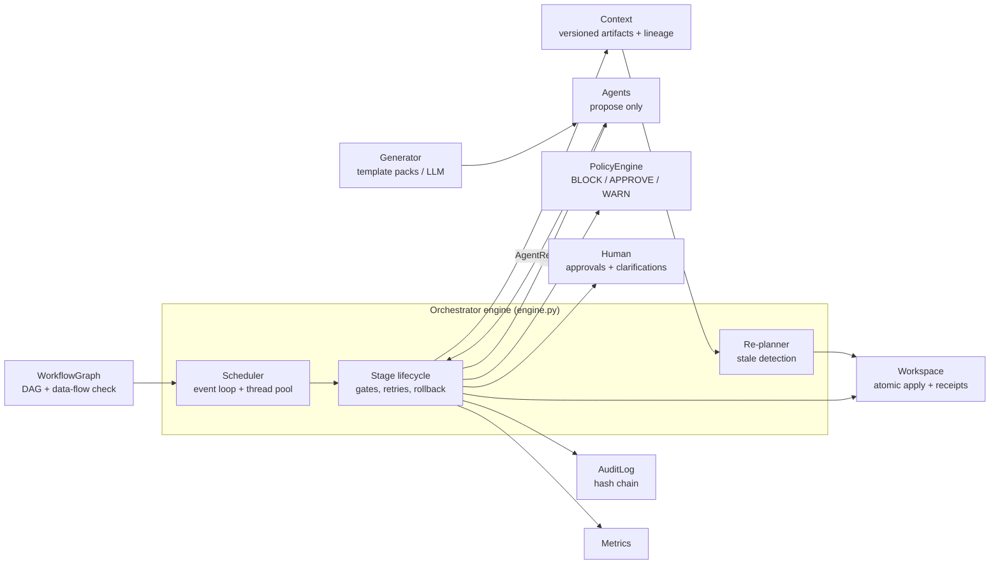
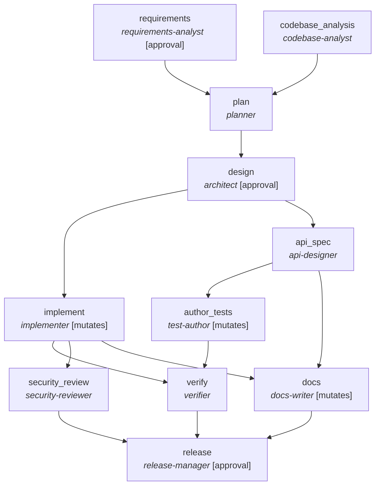
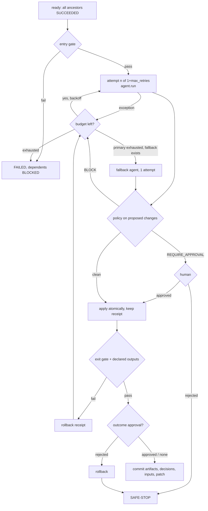

# Architecture overview

## 1. Design stance

Software delivery is a **stateful graph with governance**, not a chain of prompts. Three rules shape everything:

1. **Agents propose, the engine disposes.** An agent returns artifacts, decisions and *proposed* workspace
   changes. It cannot write files, approve anything or skip a gate. The engine runs policy, asks humans,
   applies changes atomically, verifies, and can undo.
2. **Everything is versioned and attributable.** Each artifact has content-hashed versions; each stage records
   which input versions it consumed; each decision records its actor, rationale, alternatives and input versions.
3. **Autonomy is bounded.** Retries, run-level retry budget, fallback, kill-switch and human approvals are
   explicit engine behaviours, not agent promises.

## 2. Components



| Component | Responsibility | Why it is separate |
|---|---|---|
| `graph.py` | Validates acyclicity, unknown deps and **data-flow** (a stage may only consume artifacts an ancestor produces); answers `ready()`, `descendants()`, parallel `levels()` | Orchestration structure is data, checkable before anything runs |
| `engine.py` | Scheduling and the stage lifecycle (section 4) | Single place where controls are enforced |
| `workflow.py` | The SDLC graph, entry/exit gates, approval specs | Policy of *what good looks like* per stage lives with the graph, not in agents |
| `context.py` | Artifact store (hash-versioned), decision log, persistence | Cross-stage memory and lineage; powers change propagation |
| `policy.py` | Content and path rules; evaluated on every proposed change set | Guardrails apply to any producer, including an LLM |
| `workspace.py` | Atomic apply, pre-image **receipts**, path-scoped revert, unified diffs | Cheap, precise rollback without VCS coupling |
| `approvals.py` | Human decisions and clarification questions (scripted / interactive / reject-all) | Humans are a first-class, auditable dependency |
| `audit.py` | Append-only JSONL where each entry embeds the hash of the previous one | Tamper-evident trail; `verify-audit` detects edits |
| `metrics.py` | Success rate, first-attempt rate, retries, rollbacks, MTTR, latency, approval wait | Reliability is measured, not asserted |
| `agents/` | Requirements, codebase analysis, planning, design, API contract, implementation (+safe mode), tests, verification, security review, docs (+minimal), release | Small single-purpose units with typed inputs/outputs |
| `packs/` | Template-backed generator; the shortener as 5 feature packs (`core`, `expiry`, `ratelimit`, `blocklist`, `secheaders`) | Deterministic and offline; same interface an LLM would implement |

## 3. The workflow graph



Longest-path layering shows the available concurrency:
`[codebase_analysis, requirements] -> plan -> design -> [api_spec, implement] -> [author_tests, docs, security_review] -> verify -> release`.

* **Parallel paths:** requirements and codebase analysis; contract-first `api_spec` and `implement`; then tests, docs and security
  review. Parallel mutating stages own **disjoint file paths** (src vs tests vs docs), which is what makes path-scoped rollback safe.
* **Synchronisation:** `plan` joins requirements + codebase; `verify` joins implement + author_tests; `release` joins verify + security + docs.
* **A stage runs only when every ancestor is `SUCCEEDED`** (not just direct dependencies). This is what stops work from
  starting on top of upstream stages that a re-plan has reset.
* **Entry/exit gates** (examples): `design` entry needs an acyclic plan; `implement` exit requires the whole workspace to compile and
  every pack marker to exist; `verify` exit requires tests green and NFR targets met; `security_review` exit requires zero blocking findings;
  `release` exit requires all readiness checks. Every stage also has an implicit gate: it must emit every artifact it declares.
* **Contract-first:** `api_spec` derives the API contract from the plan; `author_tests` *generates* conformance tests from it
  (`tests/test_contract_generated.py`: endpoints exist, request fields exist, no undocumented paths).

## 4. Stage lifecycle (what the engine enforces for every stage)



### Failure handling matrix

| Situation | Detection | Response | Evidence |
|---|---|---|---|
| Transient agent error | exception | bounded retry with exponential backoff (default 1 + 2) | `attempt_failed`, `retries` metric |
| Agent output violates a hard rule (secret, `eval`, SQL injection, traversal) | `PolicyEngine` BLOCK | change set never applied; retry, then fallback | `policy_violation`, `policy_blocks` |
| Output compiles/gates fail **after** apply | exit gate | revert that stage's receipt, retry | `rollback` audit entry, `rollbacks` metric |
| Primary agent exhausted | retry budget | fallback agent (e.g. safe-mode implementer defers unsafe packs; minimal docs) | `fallback_engaged` |
| High-impact change (schema, PII persistence, protected path, new dependency) | `REQUIRE_APPROVAL` rule / stage approval | human decision; rejection => nothing applied + safe-stop | `approval_requested/decision` |
| Stage unrecoverable | all attempts used | stage `FAILED`, descendants `BLOCKED`; **independent branches still finish**; run `FAILED` | per-stage status table |
| Critical stage fails, human rejects, run retry budget exceeded, or `STOP` file appears | engine | **safe-stop**: no further dispatch, in-flight work drains, pending stages `SKIPPED`, state persisted | `safe_stop`, run `SAFE_STOPPED` |
| Process interrupted / reviewer rejected | `state.json` | `resume` keeps `SUCCEEDED` stages, re-attempts the rest, audit chain continues | `run_resumed` |

### Policy guardrails (`policy.py`)

| Rule | Category | Action |
|---|---|---|
| SEC-001 hard-coded secrets / private keys | security | BLOCK |
| SEC-002 `eval`/`exec`/`os.system`/`shell=True`/`pickle.load` | security | BLOCK |
| SEC-003 SQL built by interpolation | security | BLOCK |
| SEC-004 TLS verification disabled | security | BLOCK |
| SEC-005 `random` used for identifiers (use `secrets`) | security | BLOCK |
| CHG-001 path escapes workspace | change control | BLOCK |
| CHG-002 `CREATE/ALTER/DROP TABLE` in application source | change control | REQUIRE_APPROVAL |
| CHG-003 protected paths (`.github/`, `Dockerfile`, `deploy/`, `infra/`) | change control | REQUIRE_APPROVAL |
| CMP-001 client address persisted/logged (PII, data minimisation) | compliance | REQUIRE_APPROVAL |
| CMP-002 dependency not on the allowlist | compliance | REQUIRE_APPROVAL |

`security_review` additionally re-scans the **whole resulting workspace** (defence in depth) and records posture advisories
(e.g. no rate limiting) as residual risk.

## 5. Dynamic re-planning (change propagation)

Artifacts are content-hashed. A stage records the artifact versions it consumed. When an upstream artifact changes
(here: a stakeholder amends the requirement mid-run):

1. The engine **stops dispatching** and lets in-flight stages drain (quiesce), so nothing starts on stale input.
2. It finds stages whose consumed versions no longer match the current ones (**stale**).
3. For each stale stage, in reverse commit order, it **reverts that stage's receipt** (rolls back its file changes),
   marks its old decisions `superseded`, and resets it to `PENDING`.
4. Those stages re-run. If a re-run produces a **byte-identical artifact, the version does not change**, so nothing
   downstream goes stale - minimal re-execution. If it changes, the next round of staleness detection cascades onward.

Real trace from the `ambiguous` scenario (change request arrives right after `implement` finishes):

```
✎ requirement_amended  Also reject links whose destination is a known phishing domain (blocklist).
♻ replan  stale=['requirements']                          changed={'requirements': ['raw_requirement']}
♻ replan  stale=['plan', 'design']                        changed={'plan': ['requirements'], 'design': ['requirements']}
♻ replan  stale=['api_spec', 'implement', 'author_tests'] changed={'api_spec': ['plan'], ...}
↩ rollback implement: replan: 5 file(s) reverted
↩ rollback author_tests: replan: 3 file(s) reverted
```

`codebase_analysis` (unaffected) is reused, and the human approvals for requirements and design are **re-requested** because the
approved artifacts changed - the old approvals stay in the lineage as `superseded`. Unit tests prove both directions
(`test_replan_reruns_only_what_the_change_actually_affects`).

## 6. Controlled autonomy: who may do what

| Action | Agent alone | Needs human | Never |
|---|:-:|:-:|:-:|
| Analyse code, write reports/artifacts | yes | | |
| Propose a change set | yes | | |
| Apply a policy-clean change set that passes gates | yes (engine applies) | | |
| Persistent schema change, PII persistence, protected path, new dependency | | yes (policy) | |
| Resolve an ambiguity in the requirement | | answer, or **flagged assumption** that is part of sign-off | silently guess |
| Proceed past a high-impact design | | yes (`design_signoff`) | |
| Release | | yes (`release_approval`) | |
| Apply a change containing a secret / injection pattern / path traversal | | | yes (BLOCK) |
| Edit the audit log, bypass a gate, exceed retry budgets | | | yes |

## 7. Observability and traceability

* **Audit log** (`audit.jsonl`): every start/finish, attempt, gate result, policy violation, approval request and decision,
  rollback, fallback, re-plan, safe-stop, with actor (`agent:*`, `human:*`, `policy`, `orchestrator`), stage and a SHA-256 chain.
* **Decision lineage** (`lineage.json` and the summary): decision id, stage, actor, kind (clarification / assumption / plan / adr /
  approval / change_request / fallback), rationale, alternatives, trade-off, **input artifact versions**, active/superseded.
* **Metrics** (`metrics.json`): stage success rate; first-attempt success rate; retries; rollbacks; re-plans; policy blocks;
  **MTTR** (first failure of a stage to its first success); approvals and human wait time; **end-to-end latency**; per-stage attempts and time.
  `python -m orchestrator metrics` aggregates across runs.
* **Reviewable outputs:** every mutating stage produces a unified patch; design notes are emitted as `design.md`.

## 8. The product: URL shortener

Layered `api -> service -> store` (FastAPI + SQLite), with extension anchors (`# [ext:*]`) so features arrive as small, reviewable patches.

| Endpoint | Behaviour |
|---|---|
| `POST /api/v1/links` | `{url, alias?}` (+ `ttl_seconds?, max_clicks?` with expiry) -> 201; 409 alias taken; 422 invalid URL/alias/lifetime/blocked domain; 429 rate limited |
| `GET /{code}` | 307 + `Cache-Control: no-store`; 404 unknown; 410 expired / click budget spent |
| `GET /api/v1/links/{code}/stats` | total clicks, last 24 h, top referrers |
| `GET /healthz` | liveness |

Key product decisions (each is an ADR recorded in the decision lineage when its pack is delivered): SQLite single locked connection (ADR-001);
307 + no-store so analytics see every hit (ADR-002); additive nullable columns for expiry so existing data keeps working (ADR-010);
HTTP 410 for expired links (ADR-011); in-process token bucket (ADR-020); denylist enforced at creation not redirect (ADR-030);
security headers without CSP because Swagger UI would break (ADR-040). Security properties: unguessable `secrets`-based codes, http(s)-only destinations,
private/loopback/link-local/internal destinations rejected, parameterised SQL only, click budget enforced inside a `BEGIN IMMEDIATE` transaction.

## 9. Key engine decisions and trade-offs

| Decision | Alternatives | Trade-off accepted |
|---|---|---|
| Threads + event loop (`wait(FIRST_COMPLETED)`) | asyncio, external workflow engine (Temporal/Airflow) | Simple, debuggable, no infra; single process only |
| Agents are deterministic and template-backed | LLM generation now | Reproducible offline and testable; less open-ended. The `generator` interface is the LLM seam and **all guardrails already apply to it** |
| Pack-based generation with edit anchors that must match exactly once | whole-file regeneration | Reviewable diffs and brownfield realism; depends on anchors being preserved (conflicts fail closed) |
| Path-scoped receipts for rollback | git stash/branches, full snapshots | No VCS dependency, works with parallel stages; requires parallel stages to own disjoint paths |
| Hash-based change propagation | invalidate whole downstream subtree | Minimal re-execution; relies on agents being deterministic functions of their inputs |
| Approvals evaluated *after* an outcome exists (and before commit) | approve before running | Humans review a concrete artifact; costs one discarded run on rejection (rolled back) |
| Regex policy rules | full SAST | Fast and explainable; coarse. `security_review` is a second line, not a replacement for CI scanners |
| Hash-chained local audit log | external WORM/SIEM | Self-contained and tamper-evident; production should ship entries to an append-only store |
| Fallback = graceful degradation (defer unsafe packs) | fail hard | Partial progress is possible but release readiness flags `scope_complete` |

## 10. Plugging in an LLM

Implement one method and pass it to `build_registry(generator=...)`:

```python
class LLMGenerator:
    name = "llm-generator"
    def propose(self, pack: str, params: dict | None = None, include: str = "all") -> list[Change]:
        ...  # call a model with the design + codebase map; return Change(path, "write"|"edit", ...) objects
```

Its output goes through exactly the same policy evaluation, approvals, atomic apply, compile/test gates, rollback and audit as the
template generator - that is the point of the architecture.
